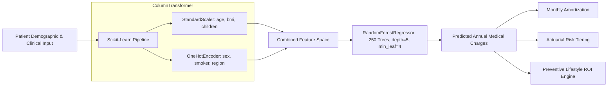

# 🏥 Healthcare Treatment & Medical Expense Predictor

[](https://www.python.org/)
[](https://scikit-learn.org/)
[](https://streamlit.io/)
[](LICENSE)
[]()
[]()

> An end-to-end clinical machine learning regression pipeline and interactive actuarial decision-support dashboard for forecasting patient healthcare treatment costs and insurance billing charges.

---

## 📌 Executive Summary

Predicting medical treatment and insurance costs is an essential capability in modern **HealthTech**, **InsurTech**, and **Hospital Financial Management**. Traditional linear actuarial tables struggle to capture complex non-linear clinical interactions—most notably, how smoking compounded with high Body Mass Index (BMI) leads to an exponential explosion in healthcare expenditures.

This project delivers a **production-ready Scikit-Learn regression pipeline** powered by `RandomForestRegressor` and `ColumnTransformer`, paired with a modern **Streamlit Web Application** featuring preventive lifestyle "What-If" simulations, risk stratification, and batch cohort processing.

---

## 🔬 Dataset & Clinical Attributes

The model is trained on the standard **U.S. Healthcare & Medical Expense Benchmark Dataset** (derived from demographic structures of the U.S. Census Bureau and the Medical Expenditure Panel Survey / MEPS by the Agency for Healthcare Research and Quality - AHRQ):

| Feature Name | Clinical / Demographic Description | Data Type | Preprocessing Transformation |
| :--- | :--- | :--- | :--- |
| **`age`** | Age of primary beneficiary (18 – 64 years) | Numerical | `StandardScaler` |
| **`sex`** | Biological sex (`male`, `female`) | Categorical | `OneHotEncoder(drop='first')` |
| **`bmi`** | Body Mass Index ($kg/m^2$, 15.0 – 53.1) | Numerical | `StandardScaler` |
| **`children`** | Number of dependent children covered | Numerical | `StandardScaler` |
| **`smoker`** | Nicotine smoking status (`yes`, `no`) | Categorical | `OneHotEncoder(drop='first')` |
| **`region`** | U.S. residential area (`northeast`, `northwest`, `southeast`, `southwest`) | Categorical | `OneHotEncoder(drop='first')` |
| **`charges`** | **Target ($y$):** Annual individual medical costs billed ($) | Continuous | Target Variable |

---

## 🏗️ Technical Architecture



---

## 📊 Empirical Results & Baseline Comparison

The tuned `RandomForestRegressor` significantly outperforms the standard industry baseline (`LinearRegression`):

| Evaluation Metric | Baseline (`LinearRegression`) | Primary Model (`RandomForestRegressor`) | Improvement / Advantage |
| :--- | :---: | :---: | :---: |
| **$R^2$ Score (Test)** | **0.7836** | **0.8784** | **+9.5 percentage points** |
| **5-Fold Cross-Validation $R^2$** | *N/A* | **0.8460 ± 0.0403** | Low variance across folds |
| **Root Mean Squared Error (RMSE)** | **$5,796.28** | **$4,345.76** | **$1,450.52 reduction** in error |
| **Mean Absolute Error (MAE)** | **$4,181.19** | **$2,491.01** | **+40.4% reduction in error** |

### 🔍 Feature Importance Analysis

Using tree Gini importance:
1. **`smoker_yes` (68.70%)**: Nicotine usage is by far the single greatest driver of healthcare expenses.
2. **`bmi` (18.25%)**: Elevated BMI drives significant cardiovascular and metabolic billing.
3. **`age` (11.93%)**: Longitudinal aging creates a steady, compounding baseline cost.
4. **`children` (0.82%)** & **`region` / `sex` (< 0.3%)**: Marginal localized variance.

> **Key Interview Takeaway:** Why does Random Forest outperform Linear Regression by **40.4% in MAE**?  
> In non-smokers, an increase in BMI raises costs linearly and moderately. However, in **smokers with BMI > 30**, costs jump abruptly from ~$15k to **over $40k**. A linear model attempts to fit a straight plane through this step-function, severely under-predicting high-risk patients and over-predicting low-risk patients. Decision trees split this interaction cleanly at `smoker == 1` and `bmi >= 30.0`.

---

## 🚀 Quickstart & Setup

### 1. Installation
Clone the repository and install required packages:
```bash
git clone https://github.com/<your-username>/healthcare-medical-expense-predictor.git
cd healthcare-medical-expense-predictor
pip install -r requirements.txt
```

### 2. Train the Pipeline
To retrain the models and regenerate serialized artifacts (`artifacts/model_pipeline.joblib`, `metrics.json`):
```bash
python train.py
```

### 3. Launch the Interactive Web Dashboard
Run the Streamlit application:
```bash
streamlit run app.py
```
Open your browser at `http://localhost:8501`.

### 4. Run Command-Line Inference
Predict for an individual patient directly via CLI:
```bash
# High-risk profile example
python predict.py --age 45 --sex female --bmi 32.5 --children 2 --smoker yes --region southeast

# Healthy low-risk profile example
python predict.py --age 25 --sex male --bmi 22.0 --children 0 --smoker no --region northeast
```

### 5. Run Automated Test Suite
Run the unit and integration tests:
```bash
python test_project.py
```

---

## 🖥️ Streamlit Dashboard Features

1. **🩺 Patient Expense Forecaster:** Dual-mode BMI calculator (direct BMI slider or height/weight entry), real-time annual and monthly forecast cards, actuarial risk badge (`Low`, `Moderate`, `Elevated`, `High`), treatment expense breakdown (inpatient, outpatient, pharmacy), and benchmark comparison against the U.S. national mean ($13,270).
2. **💡 Preventive Lifestyle What-If Simulator:**
   - **Smoking Cessation Calculator:** Quantifies the exact dollar savings per year (often $30,000+/year) and 10-year cumulative savings from quitting smoking.
   - **Weight Management / BMI Target Slider:** Shows real-time savings from lowering BMI into healthy ranges.
   - **10-Year Longitudinal Aging Curve:** Visualizes how medical liabilities scale as the patient ages.
3. **📊 Model Insights & Feature Importance:** Live inspection of model evaluation metrics, interactive horizontal bar charts of feature weights, and interactive scatter plots demonstrating the non-linear Smoker × BMI multiplier.
4. **📁 Cohort & Actuarial Batch Processing:** Upload CSV files to generate bulk predictions, total cohort liability estimates, and download scored CSV reports.

---

## 📄 ATS-Optimized Resume Project Entry

You can copy and paste this bullet block directly into your resume:

```text
Healthcare Treatment & Medical Expense Predictor                                      [GitHub Link]
Python, Scikit-learn, RandomForestRegressor, ColumnTransformer, Pandas, Streamlit, Plotly
• Engineered an end-to-end predictive regression pipeline utilizing `RandomForestRegressor` and `ColumnTransformer` to forecast individual medical treatment costs across 1,300+ patient clinical and demographic records.
• Formulated data preprocessing with OneHotEncoder and StandardScaler, tuning tree depth and leaf regularization to model complex non-linear interactions between smoking status and high BMI thresholds.
• Outperformed baseline linear regression with an R² of 0.8784 and reduced Mean Absolute Error (MAE) by 40.4% (from $4,181 to $2,491) on unseen test data, validated via 5-fold cross-validation (0.846 R²).
• Developed an interactive Streamlit clinical dashboard with preventive lifestyle "What-If" simulations, allowing actuaries and patients to quantify annual financial returns from smoking cessation and BMI normalization.
```

---

## 📂 Project Directory Structure

```text
Healthcare Treatment & Medical Expense Predictor/
├── artifacts/
│   ├── baseline_pipeline.joblib      # Serialized Linear Regression baseline
│   ├── feature_importance.json       # Exported feature weights
│   ├── metrics.json                  # Complete R2, RMSE, MAE, CV evaluation
│   └── model_pipeline.joblib         # Serialized production RandomForest pipeline
├── data/
│   └── insurance.csv                 # Clean benchmark dataset
├── app.py                            # Streamlit interactive application
├── predict.py                        # Programmatic inference & CLI tool
├── README.md                         # Project documentation
├── requirements.txt                  # Dependency specifications
├── test_project.py                   # Automated unit & integration test suite
└── train.py                          # Full model training and evaluation script
```

---

## 📜 License
This project is licensed under the MIT License.
